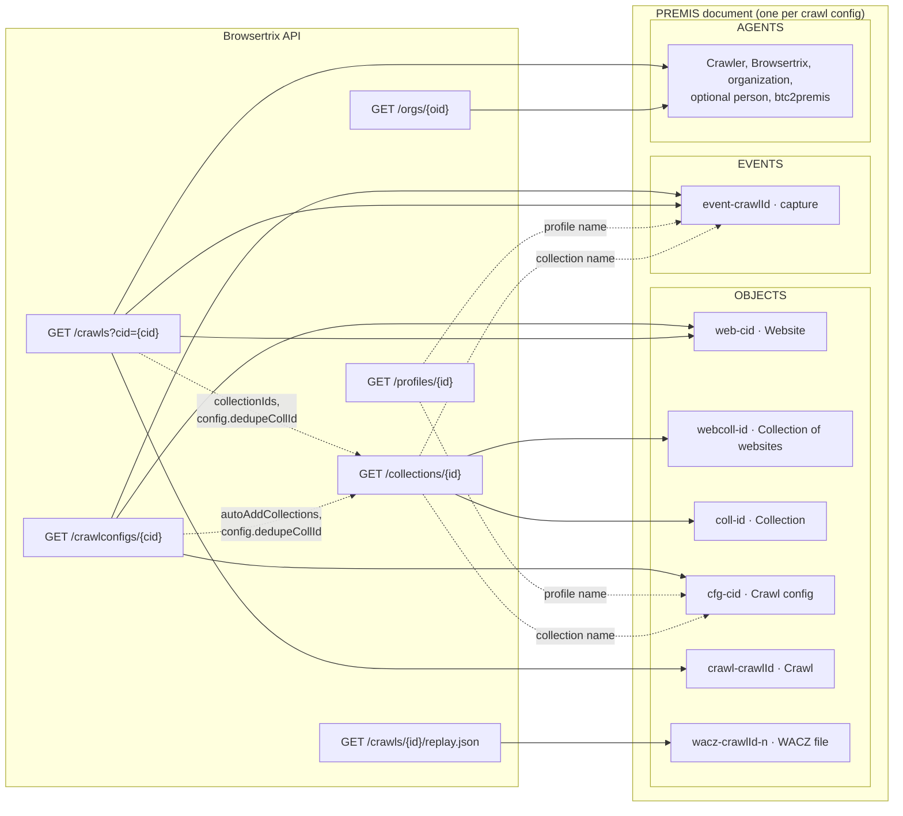
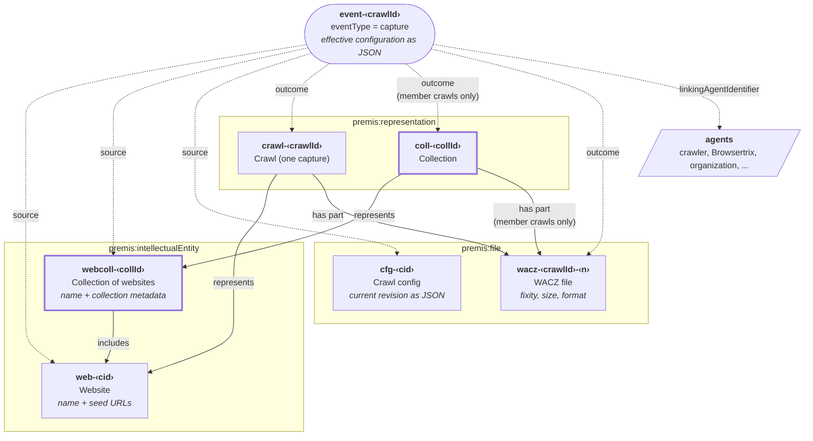
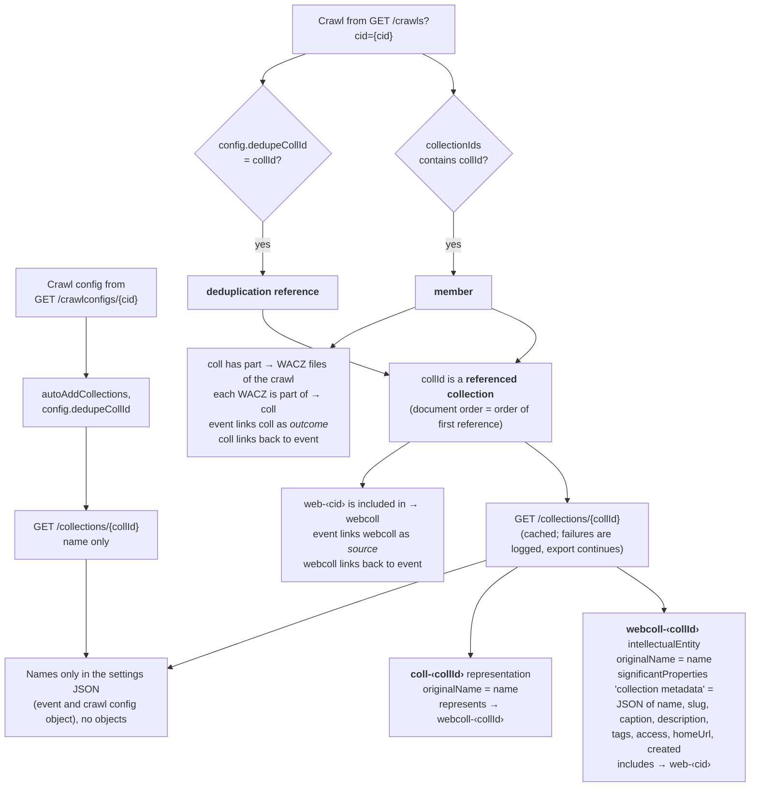
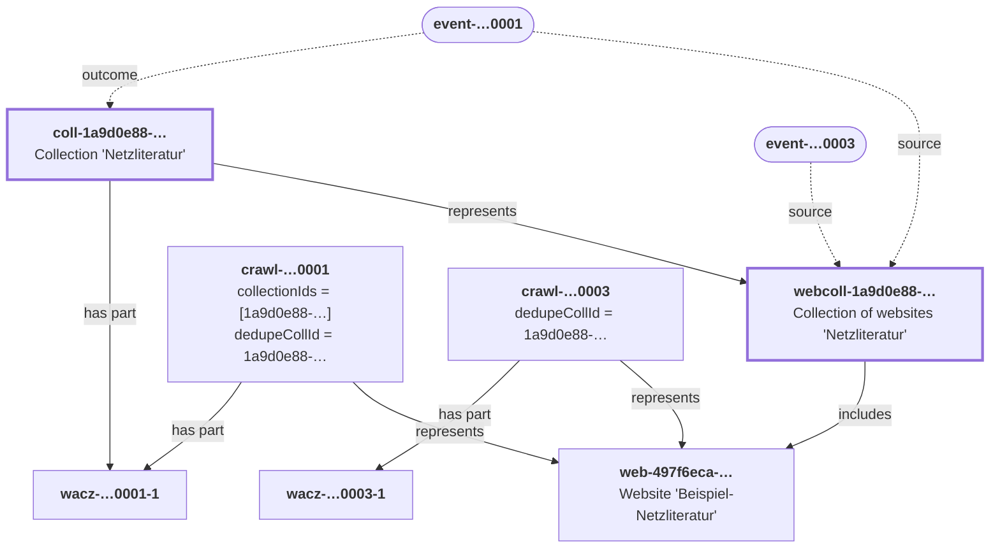
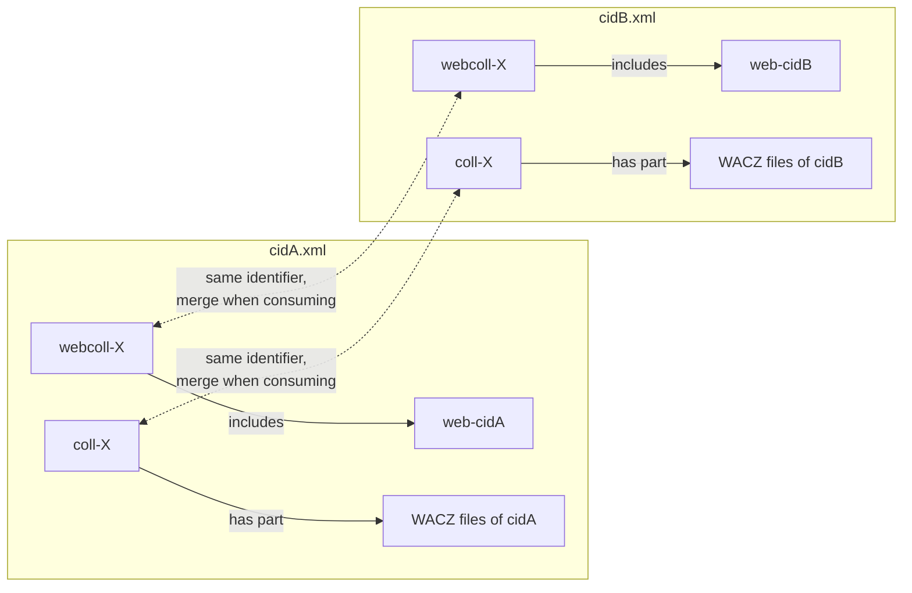

# Mapping: Browsertrix → PREMIS 3.0

This document describes how `btc2premis` maps the technical metadata from the
Browsertrix Cloud API to [PREMIS 3.0](https://www.loc.gov/standards/premis/v3/index.html).

> **Work in progress:**
> This mapping is preliminary and subject to change.
> Element names and JSON keys have not been finalized.

## Overview

The diagrams below summarize the mapping; the following sections give the
details. All diagrams use [Mermaid](https://mermaid.js.org/) and are rendered
directly on GitHub.

### Data flow: API endpoints → PREMIS document

For each crawl config, `btc2premis` reads several API endpoints, links the
responses and writes one PREMIS document. Collections are only looked up for
the IDs referenced by the crawl config and its crawls.



### Object model

Each box is a PREMIS object; solid arrows are structural relationships
(`relationshipSubType`), dashed arrows are links of the capture event
(`linkingObjectRole`). Inverse relationships (`is included in`, `is part of`)
and the `linkingEventIdentifier` back-links are omitted for readability.
Objects with a thick border are created per referenced collection
(see [section 7](#7-collections)).



Read in two parallel "lines":

| Level | Single website | Collection |
| --- | --- | --- |
| Intellectual entity (what is preserved) | `web-‹cid›` – the website of the crawl config | `webcoll-‹collId›` – the collection of websites, *includes* the website |
| Representation (one manifestation) | `crawl-‹crawlId›` – one capture, *represents* the website | `coll-‹collId›` – the Browsertrix collection, *represents* the collection of websites |
| Files | `wacz-‹crawlId›-‹n›` – *part of* the crawl | the same WACZ files, additionally *part of* the collection |

## 1. Document structure

For each crawl config (`cid`, called "Workflow" in the Browsertrix web UI), one
PREMIS document is created with the following structure:

| PREMIS element | Content | Source |
| --- | --- | --- |
| `object xsi:type="premis:intellectualEntity"` | The **website** harvested by the crawl config, with all known seed URLs | `GET /api/orgs/{oid}/crawlconfigs/{cid}`, crawls |
| `object xsi:type="premis:intellectualEntity"` | Per referenced collection: the **collection of websites**, with the descriptive metadata of the collection | `GET /api/orgs/{oid}/collections/{id}` |
| `object xsi:type="premis:representation"` | Per referenced collection: the **collection** itself | `GET /api/orgs/{oid}/collections/{id}`, crawls |
| `object xsi:type="premis:file"` | The **crawl config**, with its current revision as JSON | `GET /api/orgs/{oid}/crawlconfigs/{cid}` |
| `object xsi:type="premis:representation"` | A crawl (one capture of the website) | `GET /api/orgs/{oid}/crawls?cid={cid}` |
| `object xsi:type="premis:file"` | A WACZ file of a crawl | `GET /api/orgs/{oid}/crawls/{crawlId}/replay.json` (`resources`) |
| `event` (`eventType` = `capture`) | A crawl, including the configuration in effect for that crawl | Crawl + crawl config |
| `agent` | Browsertrix Crawler (with actual version), Browsertrix, organization, optional person, `btc2premis` | Crawl, org |

For orientation, the document is divided into the sections `OBJECTS`, `EVENTS`
and `AGENTS` by comments; each entry is preceded by a short comment (for
example `<!-- Capture of crawl a1b2c3d4-... -->`) and separated from the next
one by a blank line.

Relationships:

* Representation *represents* → website (with `relatedEventIdentifier` → its
  capture event), *has part* → each WACZ file
* WACZ file *is part of* → representation (and → collection, see below)
* Collection of websites *includes* → website; website *is included in* →
  collection of websites
* Collection *represents* → collection of websites, *has part* → WACZ files of
  its member crawls
* Event `linkingObjectIdentifier` → website, collections of websites and crawl
  config (`source`), representation, collections and WACZ files (`outcome`);
  `linkingAgentIdentifier` → agents
* Website, collections of websites, representations, WACZ files and crawl
  config link back to their events via `linkingEventIdentifier`

The crawl config object stands for the crawl config as a whole and is linked to
all of its crawls, just as every crawl refers to its crawl config via `cid`.
Browsertrix, however, keeps only the current revision (`rev`) of a crawl
config; each crawl records the revision it was started with (`cid_rev`). The
JSON of the crawl config object therefore shows the current revision only.
Earlier revisions are not invented as PREMIS objects; the configuration of
every crawl is documented in its event instead (see
[section 6](#6-crawl-configuration-json)).

The role `source` for the crawl config is preliminary: the crawl config is an
input of the crawl rather than its source in the sense the website is, but the
PREMIS vocabulary for `eventRelatedObjectRole` only offers `source` and
`outcome`. A role such as `input` is still under discussion.

## 2. Identifiers

All identifiers have the type `local`. Their values consist of a prefix naming
the kind of entity and the Browsertrix ID of the underlying record, so they
stay readable and can be traced back to Browsertrix directly:

| Object | Value | Example |
| --- | --- | --- |
| Website | `web-` + `cid` | `web-497f6eca-...` |
| Collection of websites | `webcoll-` + collection ID | `webcoll-1a9d0e88-...` |
| Collection | `coll-` + collection ID | `coll-1a9d0e88-...` |
| Crawl config | `cfg-` + `cid` | `cfg-497f6eca-...` |
| Representation (crawl) | `crawl-` + crawl ID | `crawl-a1b2c3d4-...` |
| WACZ file | `wacz-` + crawl ID + `-` + number of the file (from 1, in the order of `replay.json`) | `wacz-a1b2c3d4-...-1` |
| Event | `event-` + crawl ID | `event-a1b2c3d4-...` |
| Agent | `agent-` + org ID or user ID, otherwise name (and version) | `agent-browsertrix-crawler-1.6.1` |

Names in agent identifiers are reduced to lower-case letters, digits, `.` and
`-`. Since every value starts with a letter, it can also be used as `xsd:ID`.
The identifiers are deterministic: repeated runs of `btc2premis` produce
byte-for-byte identical documents for unchanged data.

## 3. WACZ files (`premis:file`)

| PREMIS | Browsertrix | Note |
| --- | --- | --- |
| `objectCharacteristics/compositionLevel` | – | constant `0` |
| `fixity/messageDigestAlgorithm` | derived from `resources[].hash` | `SHA-256`; MD5 receives the profile suffix "(deprecated)" |
| `fixity/messageDigest` | `resources[].hash` | The `sha256:` prefix is removed |
| `size` | `resources[].size` | in bytes |
| `format/formatDesignation/formatName` | file extension | `WACZ` or `WARC, Web ARChive file format` |
| `format/formatRegistry` | file extension | second `format` block with `Media types` / `application/wacz` |
| `originalName` | `resources[].name` | |
| `creatingApplication` | `image` of the crawl | `Browsertrix Crawler` + version |
| `storage/contentLocation` | `resources[].name` | Type `Path`, value `./<filename>` |

The `path` URL returned by the API is **presigned** and expires; it is therefore
intentionally not included in the metadata. PRONOM PUIDs are not yet recorded and
can be added in `mapping.FORMATS`.

## 4. Website and crawl config objects

| PREMIS | Browsertrix | Note |
| --- | --- | --- |
| Website `significantProperties` (type `seed URL`) | `config.seeds[].url` of the crawl config and of all crawls, `firstSeed` | one entry per distinct URL |
| Website `originalName` | `name` | |
| Crawl config `significantProperties` (type `crawl configuration`) | crawl config | JSON, see section 5 |
| Crawl config `objectCharacteristics/format` | – | `JSON`, media type `application/json` |

The crawl config object deliberately has no `fixity`, `size`, `originalName`
or `storage`: it is a database record of Browsertrix, not a stored file.

## 5. Event per crawl

| PREMIS | Browsertrix |
| --- | --- |
| `eventType` | constant `capture` |
| `eventDateTime` | `started` |
| `eventDetail` (1st) | Plain-text description with crawler software + version, crawl config ID and revision, and crawl ID |
| `eventDetail` (2nd) | Configuration in effect for the crawl, as JSON (see below) |
| `eventOutcome` | `state` |
| `eventOutcomeDetailNote` | JSON with `state`, `started`, `finished`, `crawlExecSeconds`, `stats.done`, `stats.found`, `pageCount`, `errorPageCount`, `fileCount`, `fileSize` |
| `linkingAgentIdentifier` | Crawler (`executing program`), Browsertrix (`implementer`), organization (`authorizer`), optional person (`operator`), `btc2premis` (`metadata creator`) |

The actual crawler version comes from the `image` field of the crawl (for example,
`docker.io/webrecorder/browsertrix-crawler:1.6.1`) and is split into
`agentName` + `agentVersion`; the full image string remains in `agentNote`.

## 6. Crawl configuration (JSON)

Browsertrix settings have no native PREMIS equivalents. Instead of a custom XML
namespace, they are embedded as JSON in CDATA sections of plain PREMIS string
elements:

* per crawl in the second `event/eventDetailInformation/eventDetail` – the
  settings in effect for that crawl,
* for the crawl config in
  `object/significantProperties/significantPropertiesValue` – the current
  revision of the configuration.

Both JSON documents share the same structure:

```json
{
  "crawlConfigId": "497f6eca-...",
  "crawlConfigRevision": 2,
  "crawlId": "a1b2c3d4-...",
  "settings": { "scope": {...}, "limits": {...}, "...": {...} },
  "inheritedFromCrawlConfig": {
    "crawlConfigRevision": 3,
    "settings": ["limits.crawlTimeoutSeconds", "scheduling.crawlSchedule", "..."]
  }
}
```

`crawlId` and `inheritedFromCrawlConfig` only occur in the event. The keys of
`settings` follow the API field names so the origin remains traceable. Empty
values are omitted.

| Browsertrix UI group | `settings` key | API field |
| --- | --- | --- |
| Scope | `scope.scopeType` | `config.scopeType` |
| | `scope.startUrl` | `config.seeds[0].url` or `firstSeed` |
| | `scope.maxDepth` | `config.depth` |
| | `scope.extraHops`, `scope.includeLinkedPages` | `config.extraHops` (>0 ⇒ `true`) |
| | `scope.useRobots` | `config.useRobots` |
| | `scope.useSitemap` | `config.useSitemap` |
| | `scope.selectLinks` | `config.selectLinks` |
| | `scope.alwaysAddBehaviorLinks` | `config.alwaysAddBehaviorLinks` |
| | `scope.additionalPages` | `config.seeds[1:].url` |
| | `scope.include`, `scope.exclude` | `config.include`, `config.exclude` |
| | `scope.failOnFailedSeed`, `scope.failOnContentCheck` | same-named fields |
| | `scope.seeds` | complete seed list including seed-specific scope rules |
| | `scope.dedupeCollection` | `config.dedupeCollId` (+ resolved collection name) |
| Crawl limits | `limits.maxPages` | `config.limit` |
| | `limits.crawlTimeoutSeconds` | `crawlTimeout` |
| | `limits.maxCrawlSizeBytes` | `maxCrawlSize` |
| Page behavior | `pageBehavior.behaviors`, `autoscroll`, `autoclick` | `config.behaviors` |
| | `pageBehavior.clickSelector` | `config.clickSelector` |
| | `pageBehavior.customBehaviors` | `config.customBehaviors` |
| | `pageBehavior.behaviorTimeoutSeconds` | `config.behaviorTimeout` |
| | `pageBehavior.pageLoadTimeoutSeconds` | `config.pageLoadTimeout` |
| | `pageBehavior.postLoadDelaySeconds` | `config.postLoadDelay` |
| | `pageBehavior.pageExtraDelaySeconds` | `config.pageExtraDelay` |
| Browser settings | `browserSettings.browserProfileId`, `browserProfileName` | `profileid`, `profileName` or `/profiles/{id}` |
| | `browserSettings.browserWindows`, `scale` | `browserWindows`, `scale` (deprecated) |
| | `browserSettings.crawlerChannel` | `crawlerChannel` |
| | `browserSettings.crawlerImage` | `image` (only available for the crawl) |
| | `browserSettings.proxyId` | `proxyId` |
| | `browserSettings.blockAds` | `config.blockAds` |
| | `browserSettings.saveStorage` | `config.saveStorage` |
| | `browserSettings.userAgent` | `config.userAgent` |
| | `browserSettings.language` | `config.lang` |
| Scheduling | `scheduling.crawlSchedule` | `schedule` (Cron) |
| Collections | `collections.autoAddToCollection` | `autoAddCollections` (+ resolved name) |
| | `collections.collection` | `collectionIds` of the run |
| Metadata | `metadata.name`, `description`, `tags` | same-named fields |
| | `metadata.jobType`, `created`, `createdBy`, `modified`, `modifiedBy`, `revision` | `jobType`, `created`, `createdByName`, `modified`, `modifiedByName`, `rev` |

**Fallback rule:** For a crawl, the API does not provide all fields (for
example `crawlTimeout`, `maxCrawlSize`, `schedule`, crawl config metadata).
Missing values are supplemented from the *current* crawl config; values from
the crawl always take precedence. Every supplemented value is listed in
`inheritedFromCrawlConfig.settings`, together with the revision it was taken
from. If that revision differs from `crawlConfigRevision`, these values may not
match what was actually in effect for the crawl. `metadata.modified`,
`metadata.modifiedBy` and `metadata.revision` describe only the current
revision and are therefore never supplemented.

Person-related information (Browsertrix user accounts) is only included with
`--include-users`.

## 7. Collections

A crawl refers to Browsertrix collections in two ways:

* `collectionIds` – the crawl **belongs to** the collection (for example via
  `autoAddCollections` of its crawl config, or added manually later),
* `config.dedupeCollId` – the crawl was **deduplicated against** the
  collection.

Every collection referenced in one of these ways by a crawl of the document
results in

* an intellectual entity `webcoll-<id>` (collection of websites) that
  *includes* the website and carries the collection's name as `originalName`
  and its descriptive metadata (`name`, `slug`, `caption`, `description`,
  `tags`, `access`, `homeUrl`, `created`) as JSON in `significantProperties`
  (type `collection metadata`),
* a representation `coll-<id>` (the collection) that *represents* the
  collection of websites and *has part* the WACZ files of the crawls that
  belong to it.

Events link the collection of websites as `source` for both kinds of
reference, and the collection as `outcome` only for crawls that belong to it.
`autoAddCollections` of the crawl config is not evaluated on its own: it only
takes effect for future crawls, whose membership then shows up in
`collectionIds`.

### How collection references are processed



Effect of each kind of reference:

| Effect in the PREMIS document | Crawl is member (`collectionIds`) | Crawl deduplicated against collection (`config.dedupeCollId`) | Crawl config `autoAddCollections` only |
| --- | :---: | :---: | :---: |
| Objects `webcoll-‹collId›` and `coll-‹collId›` created | ✔ | ✔ | – |
| `webcoll` *includes* `web`; `web` *is included in* `webcoll` | ✔ | ✔ | – |
| Event → `webcoll` (`source`), `webcoll` → event | ✔ | ✔ | – |
| Event → `coll` (`outcome`), `coll` → event | ✔ | – | – |
| `coll` *has part* WACZ files; WACZ *is part of* `coll` | ✔ | – | – |
| Settings JSON of the event | `collections.collection` | `scope.dedupeCollection` | `collections.autoAddToCollection` (inherited from the crawl config) |
| Settings JSON of the crawl config object | – | `scope.dedupeCollection` (if set on the crawl config) | `collections.autoAddToCollection` |

A collection referenced by deduplication only therefore still gets both
objects, but its `coll-‹collId›` representation has no parts in this
document.

### Example

In [`example-premis.xml`](example-premis.xml), the crawl config
`Beispiel-Netzliteratur` has two crawls that both reference the collection
`Netzliteratur` ([`collection.json`](../tests/fixtures/collection.json)), in
different ways: crawl `…0001` belongs to it (`collectionIds`) and was also
deduplicated against it, crawl `…0003` was only deduplicated against it
(`config.dedupeCollId`).



`wacz-…0003-1` is not part of the collection, and `event-…0003` has no
`outcome` link to `coll-1a9d0e88-…`.

Statistics and dates of a collection (`crawlCount`, `pageCount`, `totalSize`,
`dateEarliest`, `dateLatest`, `modified`, ...) are deliberately not exported:
they describe the collection across all crawl configs and change whenever
any crawl is added, while a document is only regenerated when its own crawl
config changes.

**Limitation:** a collection usually spans several crawl configs, but each
PREMIS document only covers one. The objects `webcoll-<id>` and `coll-<id>`
therefore appear, with the same identifier, in every document whose crawls
reference the collection, and each occurrence only lists the website and WACZ
files of that document. Consumers have to merge these partial descriptions.


